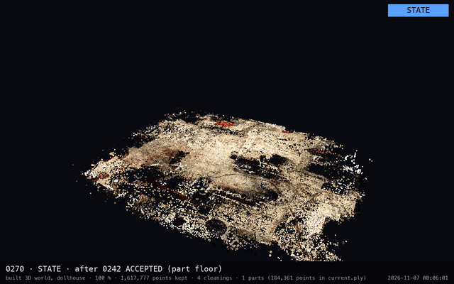
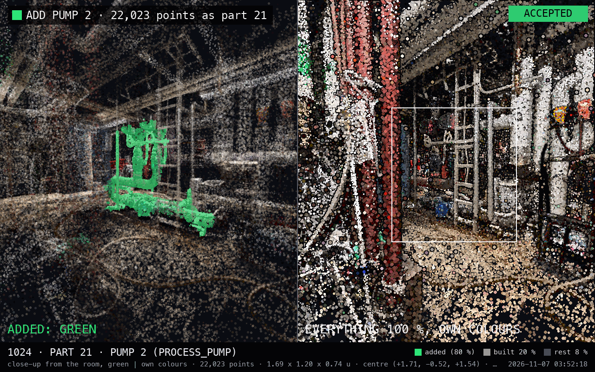
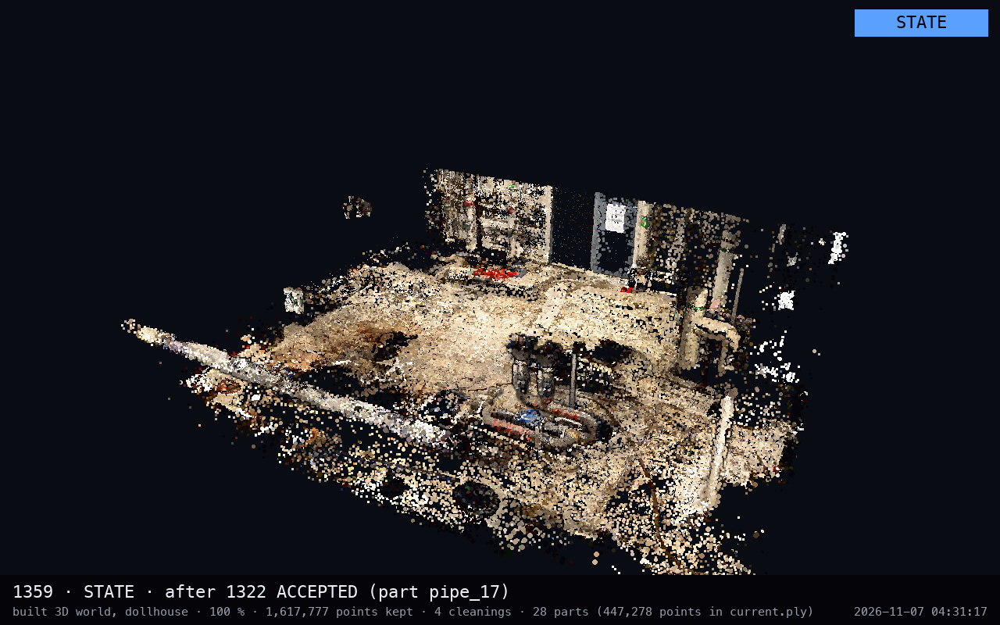
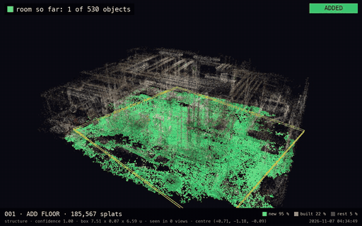
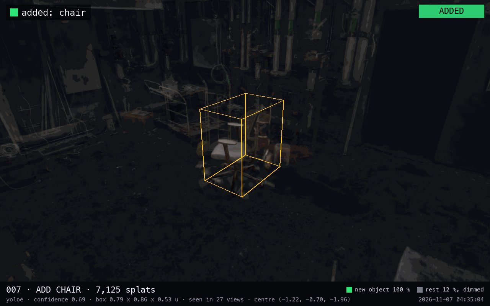
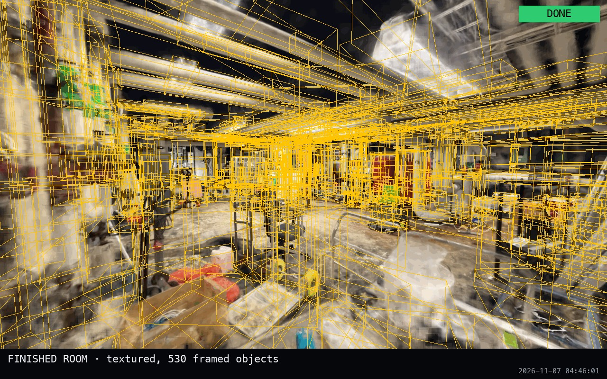
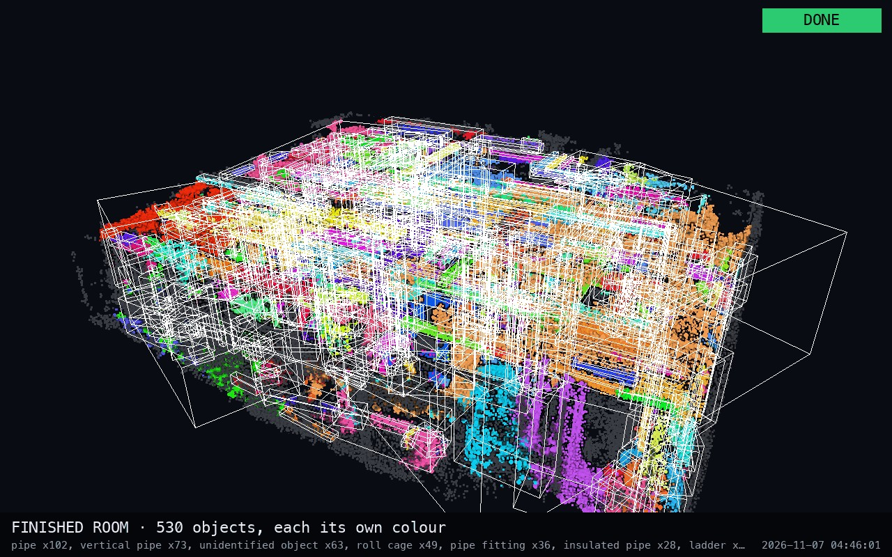

`// SINCE AI 2026 × VALMET`

# SinceAI_2026_Valmet

Making scanned industrial plants understand themselves: where equipment is, what it is, how to reach it, and why it needs attention.

**Live: [twinbuild.click](https://twinbuild.click/)**. The Equipment Room scan as a twin you can look around, measure and walk through, on desktop, on a phone and in VR on a Meta Quest 3. Open the [manual build](https://twinbuild.click/), the [automatic build](https://twinbuild.click/?scene=auto) or [both in one room](https://twinbuild.click/?scene=both), then press **Manual** or **Auto** in the build panel to choose which parts to pick from.

`HACKATHON · BUILD FRI 19:30 EET · DEADLINE SUN 10:00 · STATUS: BUILD · WEDGE: APPROVE-TO-BUILD TWIN`

## Hackathon Challenge

Imagine entering a digital industrial plant where the environment does more than look real. It understands where machines are, what they are, how people or robots could move between them and which equipment needs attention. Today's 3D captures can be visually extraordinary—but they often lack the meaning needed for intelligent action.

Valmet challenges you to bridge that gap. Explore how spatial perception, semantic 3D understanding and AI-grounded equipment information could transform a scanned industrial environment into a navigable, useful digital world. Think computer vision, point-cloud intelligence, digital twins, robotics simulation and an assistant that can explain the context behind a maintenance decision.

This is a chance to make AI understand not just words and numbers, but physical space. A strong demonstration could point toward industrial operations where service experts and autonomous systems find the right equipment faster, navigate complex facilities more intelligently and turn fragmented technical data into confident, context-aware action.

## Two builds of one room

The same scan (`Equipment Room.ply`, 1,676,481 Gaussian splats) was turned into a room of named parts twice: once by a
person deciding part by part, once by the machine alone. Both are in the repo and in the live viewer.

| | Manual build | Automatic build |
|---|---|---|
| How | [`pipeline/build.py`](pipeline/build.py) proposes one part at a time (floor, walls and pipes by geometry, equipment by probes); a person accepts or rejects it, and every step photographs itself | [`autoscene/`](autoscene/README.md): a numba splat rasteriser renders 197 views, YOLOE-26 finds objects in them, the masks are lifted to 3D by view consensus, what it missed is clustered by geometry, and a second look names each object |
| Result | **28 parts**: floor, ceiling, back wall, 2 lamps, 3 pumps, 2 control valves, a pallet jack and 17 pipes | **530 objects**: 6 structure, 198 from the detector, 326 from geometry (pipe runs, vertical pipes, fittings, unidentified objects) |
| Of the scan | 447,278 of the 1,617,777 kept splats | 1,451,642 of the 1,550,507 kept splats (94 %) |
| Decisions | 35 part proposals (28 accepted, 5 rejected, 2 replaced) and 7 cleaning proposals | none; the pictures are the review material afterwards |
| Pictures | 1,221 numbered step images in [`images/`](images/) (0139–1359) | 3 per object; a sample of 72 objects in [`autoscene/out/samples/`](autoscene/out/samples/) |
| Time | 23:22 → 04:31 EET, one person with an agent | about an hour, unattended, on an M1 laptop |

Measured against each other ([`docs/build_comparison.md`](docs/build_comparison.md), `make compare`): the automatic build
finds **23 of the 28** manual parts (3 matched, 13 split into pieces, 7 partly found, 5 missed; mean best box IoU 0.27)
and has **417 objects the manual build does not**: ladders, roll cages, barrels, chairs, cable trays, a control cabinet,
an electric motor, a pump.

### The manual build, part by part



*One frame per accepted part: the built room after each decision.* The full timelapse of the step images is
[`docs/media/manual_build.mp4`](docs/media/manual_build.mp4) (100 s, 776 of the 1,221 pictures at 8 per second: every
proposal, every view, every accept and reject).

<table>
<tr>
<td width="50%"></td>
<td width="50%"></td>
</tr>
<tr>
<td><sub>Step 1024: Pump 2 proposed (green) beside the scan in its own colours, then accepted as part 21.</sub></td>
<td><sub>Step 1359: the built twin after 28 parts, 447,278 splats, cut open at the dollhouse height.</sub></td>
</tr>
</table>

### The automatic build, object by object



*The room so far after each of the 72 sampled objects (the first 30, then every 12th), ending with the finished room.*
The video from the sample pictures is [`docs/media/auto_build.mp4`](docs/media/auto_build.mp4) (62 s: close-up, room
so far and detector proof for each sampled object, then the finished room). All 530 objects, one frame each:
[`autoscene/out/samples/flipbook.mp4`](autoscene/out/samples/flipbook.mp4).

<table>
<tr>
<td width="33%"></td>
<td width="33%"></td>
<td width="33%"></td>
</tr>
<tr>
<td><sub>Object 007: a chair (YOLOE, confidence 0.69, seen in 27 views), boxed in the dimmed room.</sub></td>
<td><sub>The finished room, textured, with the 530 object boxes.</sub></td>
<td><sub>The same room, every object in its own colour.</sub></td>
</tr>
</table>

`make media` rebuilds every file in [`docs/media/`](docs/media/) from the committed images alone, no scan needed
([`scripts/readme_media.py`](scripts/readme_media.py)).

## The web viewer

[`web/`](web/) is a three.js app over both builds (Vite + TypeScript, no framework). What it does:

- **Build switch** (top bar): Manual, Auto or Both. **Manual | Auto** buttons in the build panel choose which parts are
  choosable: in *Both* they narrow the list, the room and the click picking to one build (press again for both, the
  URL remembers it as `show=`); in a single build they switch to the other build and show its part count. There are
  530 automatic objects and 28 manual parts, so one press finds the manual parts again.
- **Scan / Model / Overlay / Wireframe** views, **True colour / Red-grey / By origin** styles (manual cyan, automatic
  amber), **Cutaway** (dollhouse), **Boxes**, **Nearby** (distance lines to the nearest parts), **Measure** (M) between
  two scan points, **Snapshot** (a reproducible `capture.html` page of the same view) and **Reset**.
- **Points | Splats** (G): the scan as a dot cloud, or as real Gaussian splats through [Spark](https://sparkjs.dev)
  ([details](#gaussian-splats)), both streamed in 5 detail levels, coarse first ([details](#detail-levels-and-loading-order)).
- **Build replay** (▶, Space, ←/→): the parts appear one by one in build order while the camera orbits.
- **Part card**: select a part (list, click or tap) for its size, position, acceptance step with the **approval images**
  (or the detector's pictures), the **nearest parts with distances** drawn as leader lines in 3D, and in *Both* the
  other build's view of the same thing: a manual part lists its automatic pieces (amber boxes), an automatic object
  links to the manual part it lies in.
- **Both builds compared**: the panel shows how many manual parts the automatic build matched, split, partly found or
  missed, with filters, and every part carries its badge.
- **Phones** (compact bar, build list as a bottom sheet, touch orbit and pinch) and **Meta Quest 3**: *Enter VR* puts
  you on the floor of the room at real-world scale, walking in your room walks you through the scan ([how](#vr-on-meta-quest-3)).

## Where we are

*As of 2026-11-07 04:31 EET (step image 1359).*

- **Master scan:** `Equipment Room.ply` (1,676,481 splats, every row real), replacing `Industrial Boiler Room (1).ply` since 2026-11-06 23:15. It is gitignored like every `.ply`; see [docs/source-data](docs/source-data/README.md).
- **Step-by-step build** ([`pipeline/build.py`](pipeline/build.py)): the twin is built one proposal at a time, and a person accepts or rejects each one. So far: 4 cleaning steps (below floor, behind wall ×2, outside the room envelope) and **28 accepted parts**: floor, ceiling, back wall, 2 lamps, 3 pumps, 2 control valves, pallet jack 1 and pipes 1–17. That is 447,278 of the 1,617,777 kept splats. The state is in [`build/manifest.json`](build/manifest.json), and every step has numbered images in [`images/`](images/) (0001–1359; 0001–0138 belong to two archived earlier runs).
- **Automatic build** ([`autoscene/`](autoscene/README.md)): 530 objects from the same scan with no human in the loop, each with its own box, label, confidence and pictures ([`autoscene/out/scene.json`](autoscene/out/scene.json)). Compared with the manual build in [`docs/build_comparison.md`](docs/build_comparison.md).
- **Web viewer** ([`web/`](web/)): [above](#the-web-viewer), live at [twinbuild.click](https://twinbuild.click/).
- **API** ([`api/main.py`](api/main.py)): scaffold only. It serves health, demo mode, scene points/stats, both viewer exports with their detail levels, the step images and the comparison.
- **Also done:** M1 clean loader (`pipeline/01_clean.py`), the xlsx → JSON dump with 30 merged `AssetRecord`s (`pipeline/05_bind_metadata.py --dump`), frozen contracts with a drift check, the timelapse and README media tools.
- **Not started yet** (planned in [`AGENTS.md`](AGENTS.md)): the browser curator with approve buttons, `data/scene_graph.json`, binding xlsx assets to parts, the occupancy grid and route, and the copilot / `Diagnosis`.

## Quick start

```bash
make setup          # Python 3.12 venv (uv), web deps (npm), data/raw -> Source-Data-Do-Not_change
make help           # every target with a one-line description
```

The `.ply` / `.mp4` files are not in git; put them in `Source-Data-Do-Not_change/` first ([how](docs/source-data/README.md#getting-the-large-files)).

| Task | Command |
|---|---|
| Show the build so far | `uv run python pipeline/build.py status` |
| Propose the next part / decide it | `uv run python pipeline/build.py part …` then `… accept` or `… reject --note TEXT` (all subcommands are listed in the [`build.py`](pipeline/build.py) docstring) |
| Look at the build in the browser | `make viewer && make web`, then open http://localhost:5173 (`?scene=auto` for the automatic build after `make viewer-auto`, `?scene=both` for both) |
| Walk the build in VR (Quest 3) | `make viewer && make web-vr`, then open `https://<laptop-ip>:5173` in Quest Browser ([details](#vr-on-meta-quest-3)) |
| Scripted screenshots | `make snap Q="src=overlay&part=pipe_3"` (needs `make web` running) |
| Timelapse of the step images | `make timelapse` → `docs/timelapse.mp4` (no Homebrew ffmpeg needed) |
| Videos and GIFs for this README | `make media` → [`docs/media/`](docs/media/) (from the committed images, no scan needed) |
| Compare the two builds | `make compare` → [`docs/build_comparison.md`](docs/build_comparison.md) |
| Tests while developing | `make test T=parts`, `make test K=lamp`, `make test-pick`, `make test-changed`, `make test-failed`; `make test-list` shows the choices; `make test-web` drives the viewer in headless Chromium |
| Before hand-off | `make check` (ruff + contract drift + every test + web typecheck/build) |
| Self-score against the brief | `python3 scoring/score.py` |

## Detail levels and loading order

`make viewer` / `make viewer-auto` also split the scan into **5 additive detail levels** ([`scripts/lod.py`](scripts/lod.py)),
written as `lod/<k>.bin` (points) and `lod/<k>.splat` (splats). The split is a voxel pyramid per part. Level 0 keeps the
most important splat (opacity × size) in each 12 cm voxel of every part and of the unclaimed scan. Each next level
halves the voxel size (6, 3, 1.5 cm), and level 4 holds the rest. Together the levels are exactly the scan, with no row
twice. Level 0 is about 4 % of the rows, so a complete, coarse room is on screen after a small fraction of the download.

The viewer loads everything lazily, in this order, each step on screen as soon as it arrives (a thin bar along the top
shows progress, and the stats line shows `detail k/5`):

1. `scene.json`: the toolbar, the parts list, the part boxes.
2. Point levels 0 → 4, coarse to fine; points are drawn larger while finer levels are missing.
3. Splats, if switched on: the Spark module, then splat levels 0 → 4. The points stay on screen until the first splat
   level is sorted and drawn, so there is no blank frame. Phones and the Quest skip the finest splat level by default;
   `?splatlod=N` sets the budget.
4. The VR module, only where WebXR VR is supported, and only after the points are in.
5. Approval images, only when a card shows them.

Each level downloads while the previous one is decoded and drawn (one level in flight ahead), so network and decoding
overlap and levels still appear strictly coarse to fine. `?scene=both` streams the same way: level *k* of the manual
export and level *k* of the automatic export, merged row by row. When everything is in, the page sets
`body[data-loaded="points"]` (and `data-splats="1"` for splats); the browser tests wait for it. In a single build the
other build's `scene.json` is fetched last, only for the part count on its Manual / Auto button.

The snapshot page still loads the full `scene.bin`, so snapshots draw every point. Exports made before the detail levels
existed still work: the viewer loads their single `scene.bin` / `scene.splat` instead.

## Gaussian splats

`make viewer` (and `make viewer-auto`) also writes `scene.splat` next to `scene.bin`: the same rows as SH-0 Gaussian
splats (position, scale, rotation, opacity, base colour), 32 bytes per splat in the `.splat` layout
([`scripts/splat_format.py`](scripts/splat_format.py)). Row *i* is the same splat in both files, so the viewer cuts
`scene.splat` into one Spark `SplatMesh` for the unclaimed scan and one per part, and gives each mesh the opacity and
tint of its role. Scan / Model / Overlay / Wireframe, Red / grey, the build replay, selection and the dollhouse cut
(a `SplatEdit` plane) all work on splats.

- Press **Splats** (or **G**, or open the viewer with `?render=splats`). The splat levels download on first use, coarse first, with progress
  on the button: about 52 MB for the 1.6 M-splat Equipment Room.
- **VR:** the right stick click switches too. Splats are much heavier than points on a headset, so start in Points and
  switch when you stand still. In VR, splats are cut at √5 standard deviations instead of 3 (about 40 % fewer pixels).
- Not on the snapshot page: `capture.html` stays point-based, so snapshots are reproducible.

## VR on Meta Quest 3

Browsers only offer WebXR on `https://` or `localhost`, so pick one of these:

- **Wi-Fi:** `make web-vr` serves HTTPS with a self-signed certificate on every interface. In Quest Browser open `https://<laptop-ip>:5173` (Vite prints the address), accept the certificate warning once, then press **Enter VR**.
- **USB cable:** `make web`, `adb reverse tcp:5173 tcp:5173`, then open `http://localhost:5173` in Quest Browser.
- **The live site:** [twinbuild.click](https://twinbuild.click/) is HTTPS, so Quest Browser shows **Enter VR** there directly.

In VR you stand on the floor of the scanned room, on open floor away from the equipment, facing the selected part (or the pump). The reference space is `local-floor`, so your real eye height and every step you take carry over 1:1: walking a metre in your room walks a metre in the scan.

| Input | Action |
|---|---|
| Walk in your room | Walk in the scan (room-scale, 1 m = 1 m) |
| Left stick | Walk where you look (stops at the room walls) |
| Right stick left/right | 30° snap turn around your head |
| Right stick click | Points ↔ Gaussian splats |
| Trigger, or pinch with hand tracking | Teleport: aim the arc at the floor and release |
| Point at equipment or a pipe | Its box lights up and a label shows name, kind and point count |
| Squeeze (grip) while pointing | Select that part (red); squeeze again to clear |
| A / X | Cycle Scan → Model → Overlay |
| B / Y | Part boxes on/off |
| Left stick click | Back to the start point |

The left controller carries a small panel showing the current view. Metric scale is still unverified. VR assumes **1 u ≈ 1.15 m**, from the pallet jack's size and the 2.6 u ceiling height. Override it with `?mpu=<metres per unit>`. To hold 72 Hz, VR leaves out the finest [detail level](#detail-levels-and-loading-order), and when frames still run long it leaves out one more level at a time, down to level 2 of 5 (the wrist panel shows `LOD n/5`). The coarse levels are spatially even, so the room stays whole, only sparser. `?xrlod=N` pins VR to levels 0..N (`?xrlod=4` draws everything). Nothing is fetched at runtime (controllers are drawn as rays, hands as spheres), so the demo also runs offline.

## Repo map

| Path | What |
|---|---|
| [`docs/`](docs/README.md) | Readable versions of the partner files (challenge brief, Excel builder pack, PLY scans, videos), a summary of every linked reference, the build comparison and the README media (`docs/media/`: the two build videos and their GIF previews) |
| [`Source-Data-Do-Not_change/`](Source-Data-Do-Not_change/) | Original partner files, read-only. `*.ply` / `*.mp4` are gitignored, see [docs/source-data](docs/source-data/README.md) |
| [`pipeline/`](pipeline/) | Offline Python. `build.py` + `stepbuild/` = the step-by-step build (cleaning filters, part detectors, CPU splat renderer, state and image numbering); `01_clean.py` = M1 clean loader; `05_bind_metadata.py` = xlsx dump + `AssetRecord` merge; `common/` = PLY reading, real-row detection, world orientation |
| [`autoscene/`](autoscene/README.md) | The automatic build: its own `uv` project (torch, ultralytics, numba), the pipeline stages, and `out/` with `scene.json` (530 objects) and the sample pictures |
| [`build/`](build/) | Build state: `manifest.json`, `parts/*.idx.npy` and `removed/*.idx.npy` (splat indices into the master scan), earlier runs in `archive/`. The `.ply` files are rebuilt from the indices and stay local |
| [`images/`](images/) | One numbered image per build step: `NNNN_YYYYMMDD-HHMMSS.png`, numbering never restarts |
| [`web/`](web/) | three.js viewer of both builds (`index.html`: Build switch and Manual / Auto buttons, Scan / Model / Overlay / Wireframe, parts list, build replay, part cards; responsive for phones; click or tap a part in the room to select it; `src/xr.ts` = WebXR walk-through for Quest 3) and the URL-driven snapshot page `capture.html` (plan/elevation views with a grid, close-ups, captions). `make viewer` exports the build, `make web` serves it, `make snap` writes numbered PNGs to `images/` |
| [`api/`](api/) | FastAPI scaffold (`make api`, port 8000); also serves the step images to the viewer (`/api/images/{name}`) |
| [`contracts/`](contracts/) | Frozen shared types: pydantic (`py/`), TypeScript (`ts/`), exported JSON Schema (`json-schema/`). `make contracts` re-exports; `make check` fails on drift |
| [`scripts/`](scripts/) | `export_viewer_scene.py` and `export_autoscene_viewer.py` (builds → web), `lod.py` (detail levels), `compare_builds.py`, `make_viewer_fixture.py` (synthetic exports for tests), `timelapse.py`, `readme_media.py`, `check_contracts.py`, `run_tests.py` (pick which tests to run) |
| [`tests/`](tests/) | pytest. Most tests use synthetic rooms; the few that read pipeline outputs (`01_clean.py`, `05_bind_metadata.py --dump`) skip until those files exist. `tests/web/` drives the viewer in headless Chromium (`make test-web`) |
| [`pm_pack/`](pm_pack/) | PM pack for the locked wedge **Approve-to-Build Twin** (generated from the source data): partner briefing questions + phone card, PRD, SWOT, risk register, roadmap, `AGENTS` context ([`AGENTS.md`](AGENTS.md) links to `06`) |
| [`scoring/`](scoring/README.md) | The brief's judging rubric broken into 18 sub-criteria, plus a self-score script |
| [`research/`](research/) | Research notes: splat cleaning, semantic extraction, navigation, three.js/WebXR, offline AI copilot, curator + metadata binding. Start at [`00`](research/00_context_and_source_data.md) |
| [`solutions/`](solutions/README.md) | Eleven candidate solution designs (S1–S11) compared on requirements and speed |
| [`analysis/ply_study/`](analysis/ply_study/README.md) | Study of the boiler-room PLY (the random-bits tail, frame, dimensions), made with [`tools/ply_study.py`](tools/ply_study.py) |
| [`design/`](design/) | **Cyberpunk v2** theme: [`cyberpunk-tokens.css`](design/cyberpunk-tokens.css) and the [guide](design/CYBERPUNK_THEME.md) |

## Credits

The viewer's source modes (Scan / Model / Overlay / Wireframe) and the snapshot page (`web/capture.html`: orthographic plan/elevation views, section cut, 0.25 u grid, readiness flag for scripted screenshots) are adapted from [wesbos/3d-model-anything](https://github.com/wesbos/3d-model-anything) (MIT, © 2026 Wes Bos). Only code ideas were reused; none of its `data/` assets are included.

## autoscene: automatic object detection and room rebuild

[`autoscene/`](autoscene/README.md) turns the splat scan into a room of named, framed objects with no human in
the loop: a numba Gaussian-splat rasteriser renders 197 views with an ID buffer, YOLOE-26 finds objects in them,
the masks are lifted to 3D by view-consensus merging, the ceiling pipe network is split into runs by local
direction, and every object gets its own PLY, an oriented box, a row in `out/scene.json` and three pictures
(textured close-up, room-so-far from outside, detector proof). Plan and research: [`autoscene/PLAN.md`](autoscene/PLAN.md).

```bash
cd autoscene && uv sync && uv run python -m autoscene.run all
```

To see the automatic build in the web viewer (build slider, boxes, cutaway, VR), export it and open the viewer with
`?scene=auto`:

```bash
make viewer-auto && make web     # then http://localhost:5173/?scene=auto
```

To see **both builds in one room**, export both and open `?scene=both` (or press **Both** in the viewer's Build
switch): the manual parts come first, then the automatic objects; parts are tagged MANUAL / AUTO in the list, the
**By origin** style colours them cyan / amber, and a part's card links to the other build's best-overlapping part.

```bash
make viewer && make viewer-auto && make web     # then http://localhost:5173/?scene=both
```

**How well does the automatic build do?** `make compare` measures it against the manual build (the human-approved
reference) from the committed boxes alone, no scan needed: each manual part is *matched*, *split* into pieces,
*partly found* or *missed*, and each automatic object is either inside a manual part or new. Results:
[`docs/build_comparison.md`](docs/build_comparison.md). In `?scene=both` the panel shows the same numbers with
status filters, every part gets a badge, a selected manual part boxes its automatic pieces in amber, and the
**Manual | Auto** buttons show one build at a time in the list and in the room too.

Without the scan (cloud sessions, CI), `make viewer-fixture` writes synthetic stand-ins for both exports from the
committed `build/manifest.json` and `autoscene/out/scene.json`, and `make test-web` runs the browser tests on them.
