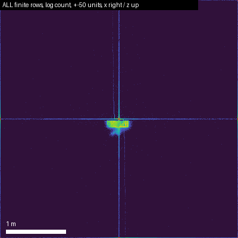
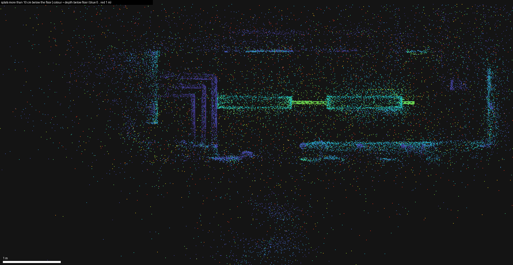
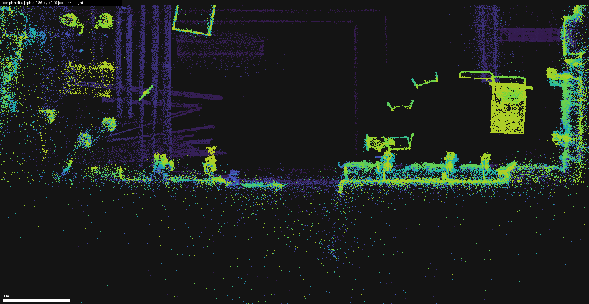
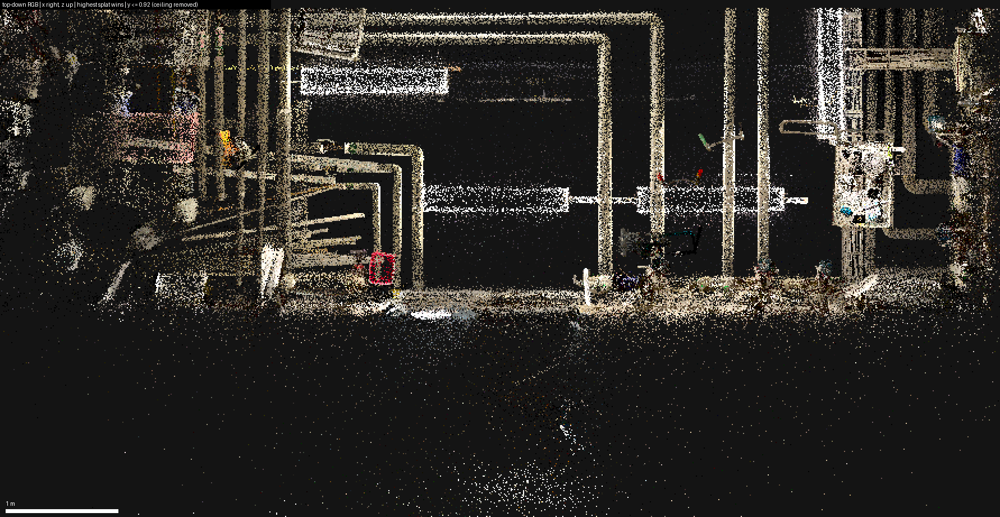
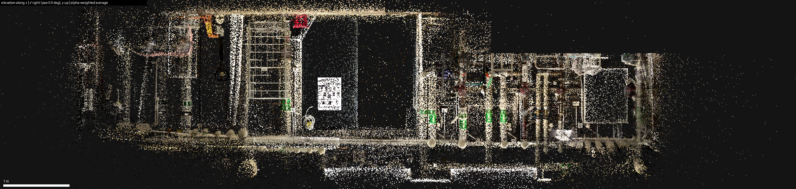
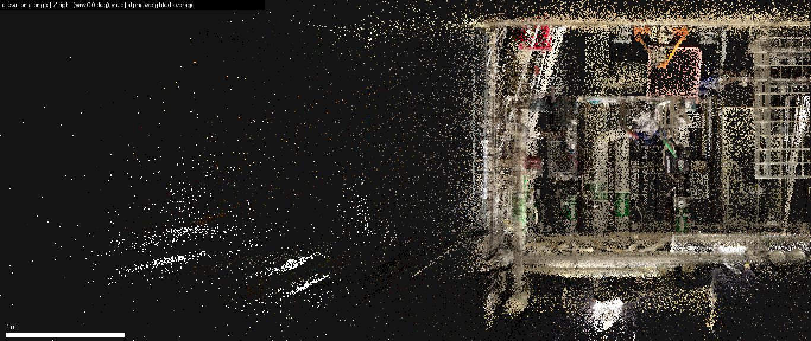

# Study of `Industrial Boiler Room (1).ply`

*Date 2026-11-06 · source file kept outside git in `Source-Data-Do-Not_change/` (355,449,599 bytes, SHA-256 `117195…6b03`, matches the `.sha256` beside it) · tool: [`tools/ply_study.py`](../../tools/ply_study.py) · all numbers below are in [`img/stats.json`](img/stats.json).*

## TL;DR

- **It is a 3D Gaussian Splatting (3DGS) scene, not a point cloud or mesh.** 59 floats per splat in the standard INRIA layout (position, log-scales, quaternion, SH colour with degree 3, opacity logit). No normals, no faces, no segmentation or labels.
- **Only the first 502,482 of 1,506,136 rows are real (33.4 %). Rows 502,482 … 1,506,135 are uniformly random bits.** The header count is wrong. Load the file by taking the first 502,482 rows (or use the derived files below); every viewer that trusts the header will draw a million NaN / 10³⁸-sized splats.
- **Coordinate frame: y is up, walls are parallel to x and z, floor at y = −0.91, ceiling at y = +1.07 (1.98 clear).** Units are not stored; everything is consistent with metres but that is not verified with a known dimension.
- **The scene is a small basement technical room, scanned from one side:** roughly 8.5 wide (x), 2.7 deep (z) in front of the back wall, with insulated pipes along the ceiling, a pump/valve cluster at the back wall, a roll cage, boxes and a washing machine on the right, and a trailing-off cluttered zone on the left.
- **About 6 % of the real splats are reflections under the floor and ~5 % floaters behind the back wall.** Clip at y < −0.95 and z < −3.45 before any geometry work.
- **Dropping the 45 higher-order SH coefficients is visually near-lossless** (they move colour by ≤ 0.02 for half of the splats) and cuts the web asset from 118.6 MB to 28.1 MB.

## 1. File structure

| Item | Value |
|---|---|
| Format | `ply`, `format binary_little_endian 1.0`, `comment Generated by EGS` |
| Elements | one `element vertex 1506136`, no faces |
| Properties | 59 × `property float`: `x y z`, `scale_0..2`, `rot_1 rot_2 rot_3 rot_0`, `f_dc_0..2`, `opacity`, `f_rest_0..44` |
| Header / body | 1,503 B header + 1,506,136 × 236 B = 355,448,096 B body, exactly the file size |
| Semantics | size = `exp(scale_i)`; quaternion `rot_0 = w`, `rot_1..3 = x y z`, stored unit-length; `rgb = 0.5 + 0.28209 · f_dc`; `alpha = sigmoid(opacity)`; `f_rest` is channel-major: `f_rest_0..14` = red coefficients 1–15, `15..29` green, `30..44` blue (SH degree 3) |
| Generator | `EGS` – not matched to any public splat tool; the file-order quirk `rot_1, rot_2, rot_3, rot_0` is unusual (most exporters write `rot_0` first). Parsers that read properties by name are fine; positional parsers would read a wrong quaternion. |

Loader rule of thumb: parse the header by property name, read 236-byte little-endian records, and **stop after row 502,481**.

## 2. Two thirds of the file is garbage

Every one of the 59 fields in rows 502,482 … 1,506,135 is random:

| Test on the tail rows | Measured | Expected for uniformly random 32-bit patterns |
|---|---|---|
| NaN share per field | 0.390 % (3,784 … 3,980 NaNs per field) | 0.391 % |
| Sign bit set | 49.6 % | 50 % |
| Entropy of the exponent byte | 7.99 bits | 8 bits |
| Value range of every field | −3.4·10³⁸ … +3.4·10³⁸ | full float32 range |
| Distance from origin | log-uniform from 10⁻⁶ to 10³⁸ | — |
| Rows passing the unit-quaternion test | 50 of 1,003,654 (all fail the range checks) | ≈ 0 |

The real rows, by contrast, are **one contiguous run from row 0 to row 502,481** with no gaps: all fields finite, `|q| = 1 ± 5·10⁻⁸`, `exp(scale) ≤ 0.994`, colours and opacities in trained ranges. The most likely explanation is an exporter that wrote a pre-allocated buffer (capacity 1,506,136) instead of the live count. An earlier quick look that reported "56 % beyond ±100 units, 20 % collapsed at the origin" was seeing this random tail through a position filter: random floats cluster near zero or at astronomical magnitudes.



*Figure 1 – all finite rows within ±50 units (log count, x right, z up). The room is the small blob; the cross along the axes is the random tail (rows with one tiny and one huge coordinate).*

## 3. Coordinate frame, scale and room geometry (real splats only)

| Fact | Value | Evidence |
|---|---|---|
| Up axis | **+y** | the y histogram is 50× peakier than x or z; its two largest planes are the floor and ceiling |
| Floor | y = **−0.91** | 10.6 % of all splats within ±3 cm; PCA plane normal tilted **0.14°** from +y; RMS thickness 2.0 cm |
| Ceiling | y = **+1.07** | 8.2 % within ±3 cm; clear height **1.98** |
| Yaw | **0.0°** | rotating the plan by 0–90° in 0.5° steps never sharpens the wall peaks |
| Back wall | z = **−3.41** (second layer at −3.17: pipes/ledge 22 cm in front) | 6.7 % + 7.1 % of splats within ±3 cm |
| Right end wall | x = **+3.61 … 3.65** | 4.2 % within ±3 cm |
| Left side | no wall; density fades out past x ≈ −4.8 | splats per metre of x: 82 k at −2.5, 55 k at −3.5, 17 k at −4.5, 8 k at −5.5 |
| Front (camera) side | nearest splats at z = −0.74; nothing captured behind the camera | 99.5-percentile of z |
| Origin (0,0,0) | 55 % across the width, **0.91 above the floor, 0.74 in front of the nearest splats** | consistent with an OpenGL-style camera-start frame: y up, scene towards −z |
| Core extent (0.5–99.5 pct) | x −4.82 … 3.88 (8.7), y −1.51 … 1.16 (2.67), z −5.17 … −0.76 (4.4) | the z range includes floaters behind the wall |
| Recommended room crop | x [−4.8, 3.65], y [−0.95, 1.12], z [−3.45, −0.74] | keeps 400,029 splats (79.6 %); 313 k of them with α ≥ 0.05 |
| Scale | **unlabelled, plausibly metres** | clear height 1.98, median splat 6.5 mm, insulated pipes ≈ 10 cm wide, floor RMS 2 cm. Not checked against a tape measure. |

Note that [`pm_pack/06`](../../pm_pack/06_AGENTS_Master_Context.md) declares scene coordinates "metres, Z up"; the partner data is **Y up**, so the importer must swap or the convention must change.

**Vertical structure** (splats per 10 cm slab of y): floor slab −1.0 … −0.8 → 152 k (30 %); equipment zone −0.7 … +0.4 → a steady 17–24 k per slab; a thin gap +0.5 … +0.9 → 6.5–11 k; ceiling band +1.0 → 45 k (9 %); above the ceiling 5.8 k (1.2 %); **more than 10 cm below the floor: 32,325 (6.4 %)**, median 32 cm deep, 90 % within 56 cm.



*Figure 2 – splats more than 10 cm below the floor (colour = depth). The pipe loop and the long pipe runs reappear mirrored under the floor, and the bright lamp reflection shows in the elevations: the sealed concrete floor is glossy enough that 3DGS modelled its reflections as virtual geometry. Pure artefact; clip at y < −0.95.*



*Figure 3 – splats between 0.05 and 1.4 above the floor, colour = height (x right, z up; the camera side is at the top, the back wall at the bottom). Equipment footprints without the ceiling pipes: pump/valve cluster along the back wall (bottom centre-right), the box-shaped unit at right (top 1.34 above the floor), clutter on the left.*



*Figure 4 – top-down RGB with the ceiling removed (highest splat wins): the insulated pipe runs hanging under the ceiling dominate, the red box and the blue valve wheels are visible.*



*Figure 5 – elevation seen along z (x right, y up, alpha-weighted average): floor line at −0.91, ceiling band at +1.07, the safety poster and the mesh roll cage left of centre, the pipe/valve wall at right, the lamp reflection under the floor.*



*Figure 6 – elevation seen along x (z right): the room occupies z ≈ −3.4 … −0.8; the sparse cloud at left is floaters behind the back wall.*

## 4. Splat properties (real block)

| Property | Distribution | What it means |
|---|---|---|
| Opacity α | median 0.124; 22.6 % < 0.05; 42.3 % < 0.1; 7.1 % > 0.5; 0.65 % > 0.9; 0.3 % < 1/255 | a "soft" model of many translucent splats; for point-cloud style processing threshold at α ≥ 0.05 (389 k splats) or weight by α |
| Size (longest axis) | median 1.4 cm, p95 6.9 cm, p99 17 cm, max 0.994 | hard cap at 1 unit (log-scale ≤ 0); nothing is bigger than the room |
| Size (shortest axis) | median 2.9 mm | |
| Anisotropy (long/short) | median 4.6, p99 9.8, max 24.5 | regularised to ≈ 10: disc-like splats hugging surfaces |
| Rotation | unit quaternions; mean `rot_0` = +0.256, mean `rot_1..3` ≈ 0 | `rot_0` is w (initialised to 1, kept positive by training); standard naming, unusual file order |
| Colour (DC) | α-weighted mean RGB (0.56, 0.51, 0.44); 34.6 % near-grey (saturation < 0.1); 5.0 % saturated (> 0.3); 36.7 % have a channel outside [0, 1] before clamping | warm grey concrete / painted brick; colour pops only on the red box, blue valve wheels, green pipe markers, orange pallet jack. Always clamp |
| Luminance | p50 0.54, p95 1.16, p99 1.46 | over-bright lamps and white walls |
| SH degree 1–3 | RMS 0.04 per coefficient vs 1.375 for DC; max view-dependent shift median 0.021, p99 0.069; 5.8 % of splats have all-zero higher SH | view dependence is tiny; degree-0 colour is enough for the demo |

## 5. Derived files (not committed, regenerate in 10 s)

| File | Content | Size |
|---|---|---|
| `data/derived/Industrial_Boiler_Room_1_clean.ply` | rows 0 … 502,481, all 59 properties, same header layout + a comment | 118.6 MB |
| `data/derived/Industrial_Boiler_Room_1_clean_sh0.ply` | same splats, 14 properties (`x y z scale_0..2 rot_0..3 f_dc_0..2 opacity`, standard order) | 28.1 MB |

Both verified: first/last records are byte-identical to source rows 0 and 502,481, every value finite. `data/derived/` is git-ignored. Regenerate (also rewrites `img/`):

```bash
uv run --with numpy --with pillow python -I tools/ply_study.py "../../Source-Data-Do-Not_change/Industrial Boiler Room (1).ply" --img analysis/ply_study/img --out data/derived
```

## 6. Consequences for the Approve-to-Build pipeline

1. **Ingest:** read the first 502,482 records only (or filter: all fields finite ∧ unit quaternion). Never trust the header count of this file.
2. **Frame:** three.js is y-up, so no axis swap; put the floor grid at y = −0.91 and the walking eye at y ≈ 0.74 (1.65 above the floor). For WebXR `local-floor` on Quest 3 translate the scene by +0.91 in y so the floor sits at 0.
3. **Clean-up before segmentation:** drop y < −0.95 (reflections), z < −3.45 (behind the wall), optionally x < −4.8 (thin tail) and α < 0.05; voxelise at 2 cm. The floor is a known plane (y = −0.91 ± 2 cm), so remove it and cluster the rest; the ceiling pipe band is y > 0.9.
4. **Web asset:** ship the SH-0 file (28 MB) or convert it to `.splat` (32 B per splat → 16 MB) / `.ksplat` / `.spz`. Loaders that parse by property name (GaussianSplats3D, gsplat.js, SuperSplat) handle both derived files; keep the full file for the offline pipeline only.
5. **Snapshots (red object / grey rest):** the colour of a splat is `0.5 + 0.28209·f_dc`; recolouring means rewriting `f_dc_*` and zeroing `f_rest_*` for the selected splats.

## 7. Open points

- `EGS` is not identifiable online, and the challenge brief only calls the file the "base 3D Gaussian Splatting environment" without naming the capture app; the true unit is unknown. Check a known length (the pallet jack ≈ 1.5–1.6 m, or the roll cage ≈ 1.7 m high) in the flythrough video if a metric claim is needed.
- The scan is one-sided: nothing behind the camera line (z > −0.74) and the far left is thin. Walking the twin will show holes there.
- 5.8 % of splats never received higher-order SH: harmless for rendering, but it means the exporter's splat set is not identical to the optimiser's final state.
