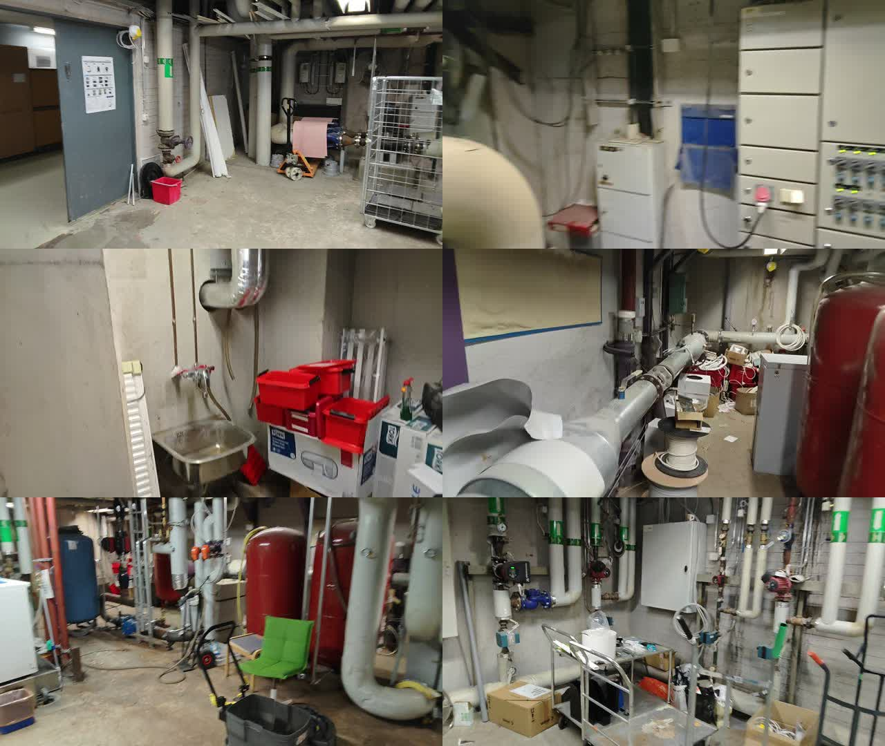
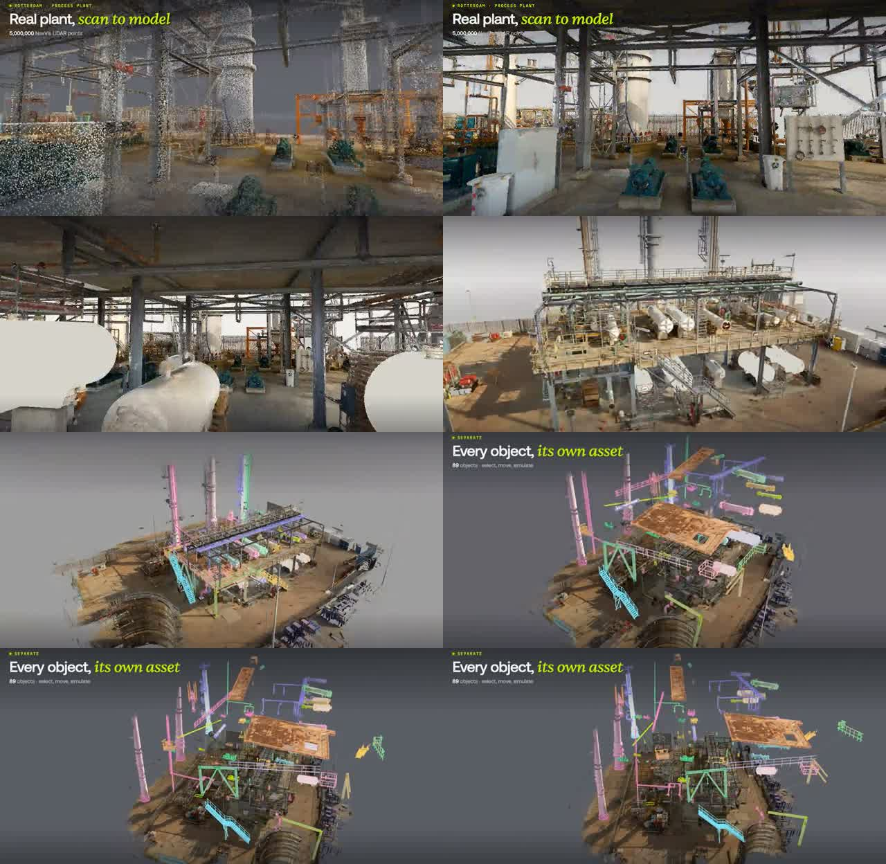
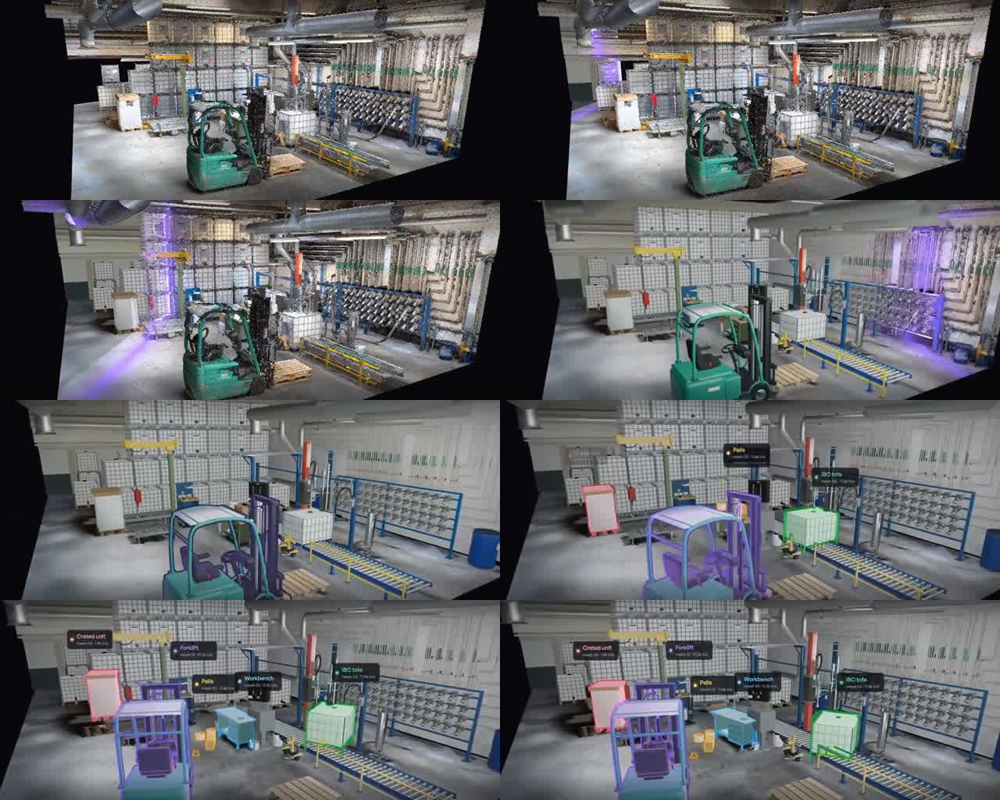
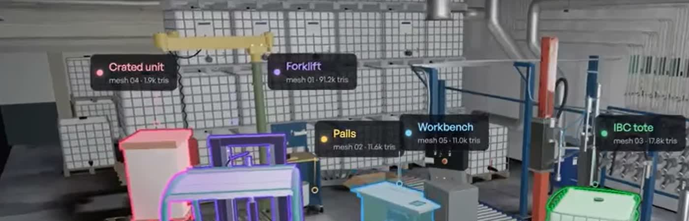

# Videos

All three are in `Source-Data-Do-Not_change/` and **not in git**. Frames were pulled with ffmpeg on 2026-11-06; the contact sheets below are in [img/](img/).

| File | Size | Length | Resolution | fps | Audio |
|---|---:|---:|---|---:|---|
| `Industrial Boiler Room (1).mp4` | 194 MB | 1:51.8 | 1920 × 1080 | 30 | mono AAC (handheld ambient) |
| `semantic extraction demo 1 (1).mp4` | 25 MB | 0:05.1 | 2456 × 1200 | 28.4 | stereo AAC |
| `semantic extraction demo 2 (1).mp4` | 15 MB | 0:09.7 | 1944 × 780 | 29.8 | stereo AAC |

## Industrial Boiler Room (1).mp4

**What it is:** a handheld phone walkthrough of the room the PLY was made from. The brief never mentions it, but it is the best way to learn what the objects in the scan actually are.

**What the room contains** (seen in the frames at 9, 27, 46, 65, 83 and 102 s):

| Object | Where / notes | Likely class for us |
|---|---|---|
| Insulated pipes (white/grey lagging) with green flow-direction arrow labels | everywhere, vertical risers and horizontal runs near the ceiling | pipe (structure) |
| **Large red cylindrical tanks** | at least two, floor-standing, ~1.5–2 m tall | expansion / pressure vessel |
| Blue cylindrical tank | next to the red ones | vessel |
| **Inline circulation pumps** (red and blue motor heads on vertical pipes) | on the pipe manifold wall | **process pump / motor** |
| Valves, strainers, gauges on the pipework | on the manifolds | **control valve / pressure transmitter** |
| Electrical switchgear / control cabinet with indicator lamps | along one wall | cabinet / panel |
| White wall-mounted boxes (controllers, junction boxes) | several | panel / sensor box |
| Heavy grey door with a safety poster | room entrance | door (scale reference!) |
| Pallet jack, roll cage, wheeled cart, wet-vac | floor | mobile obstacle |
| Red storage boxes, cardboard boxes, cable reels | floor and shelves | clutter / obstacle |
| Stainless steel wash sink with taps | one corner | fixture |
| Green chair | floor | furniture |

**Takeaways:**

- It is a real building-services plant room (heating/cooling distribution), not a paper-mill boiler hall. Pumps, valves, vessels and pressure points still map naturally onto the builder pack's asset classes.
- The floor is **cluttered**: boxes, carts and a pallet jack sit in the walkways. A realistic path must route around them, which is exactly what scoring criterion 2 rewards.
- Headroom looks like a normal 2.5–3 m basement, which suggests the PLY's 2.0-unit floor-to-ceiling height is not in metres (see the [PLY doc](../boiler-room-ply/README.md#scene-geometry-after-cleaning)).
- The door and the sink are good known-size objects for scale calibration.
- Frames from this video could also feed 2D detectors (SAM, CLIP, a VLM) for labelling, but there are no camera poses, so projecting labels into 3D would need extra work (e.g. COLMAP).

## semantic extraction demo 1 (1).mp4

**What it is:** a 5-second promotional clip of an outdoor process plant going from LiDAR scan to separated objects.

Sequence:

1. **"Real plant, scan to model"**, tagged "Rotterdam · process plant", with a caption citing a 5,000,000-point NavVis LiDAR scan. A sparse point cloud of columns, piping and pumps fades into a photorealistic model.
2. Camera flies around the photoreal model: steel structure, storage tanks (white horizontal vessels), pumps on plinths, stairs and walkways.
3. Pulls back to an aerial view of the whole unit; individual objects light up in different colours (columns pink, pipes blue, stairs cyan, structure green).
4. **"Every object, its own asset"**, captioned "89 objects · select, move, simulate". The objects are **exploded** upwards: roof plate, pipe runs, railings, stairs and vessels float apart, each a separate coloured mesh.

**Takeaways:**

- Valmet's bar for criterion 1: **dozens of separate objects** (89 here), each its own colour, including structural pieces (stairs, railings, roof plates, pipe segments), not just "equipment".
- The "exploded view" is a memorable way to prove separation. We could do the same in a few lines: offset each cluster along its centroid direction.
- Labels are not shown in this clip; colour alone signals separation.

## semantic extraction demo 2 (1).mp4

**What it is:** a 10-second clip of an indoor industrial room going from Gaussian splat to clean meshes with labelled 3D frames. This is the closest match to our task.

Sequence:

1. A splat of an indoor storage room: IBC totes stacked along the back wall, a green forklift, a jib crane, a roller conveyor, a hose rack, overhead ducts. A purple scan line sweeps across it.
2. The splat is replaced by clean, simplified meshes of the same scene.
3. Selected objects get **coloured outlines** (pink, purple, blue, green, yellow).
4. **Label cards** appear above each object.

The label cards read:

| Label | Card sub-text |
|---|---|
| Crated unit | mesh 04 · 1.9k tris |
| Forklift | mesh 01 · 91.2k tris |
| Pails | mesh 02 · 11.6k tris |
| Workbench | mesh 05 · 11.0k tris |
| IBC tote | mesh 03 · 17.8k tris |

**Takeaways:**

- This is the visual target for criteria 1 and 2: **outline + floating label card with a coloured status dot + a small ID line**, all readable at once. Our version swaps "mesh 04 · 1.9k tris" for `P-005 · health 44 · FOULING`.
- Only five objects are labelled here, while demo 1 shows 89. Valmet's brief says "the more, the better", so aim for demo 1's density with demo 2's labels.
- Plain-English object names (forklift, pails, workbench) are expected even for non-equipment. Unmapped clusters should still get a generic label (pipe, tank, cabinet, box).

## A note on these stills

The contact sheets in [img/](img/) are frames from partner-supplied videos, saved at reduced size for documentation. The full videos are gitignored on purpose. Check that sharing these stills in the repo is fine before making the repo public.
